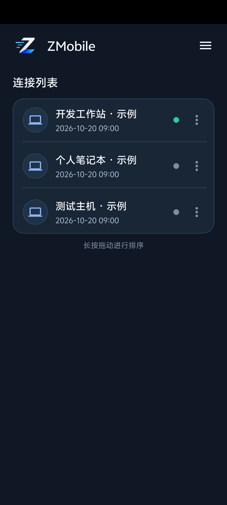
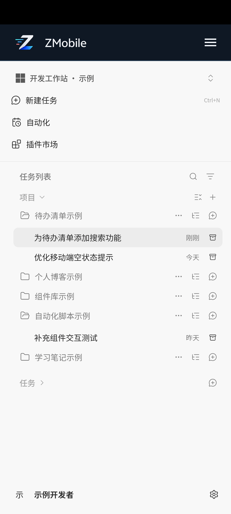
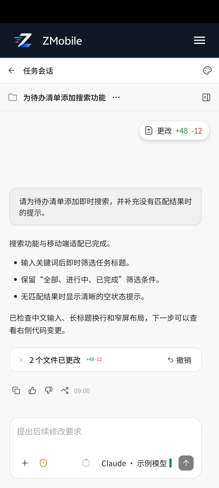
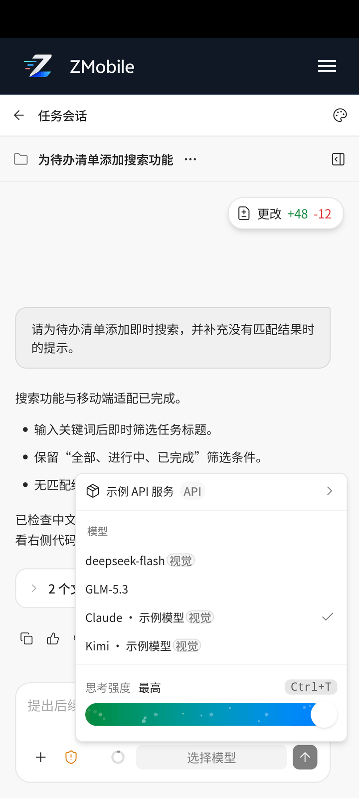
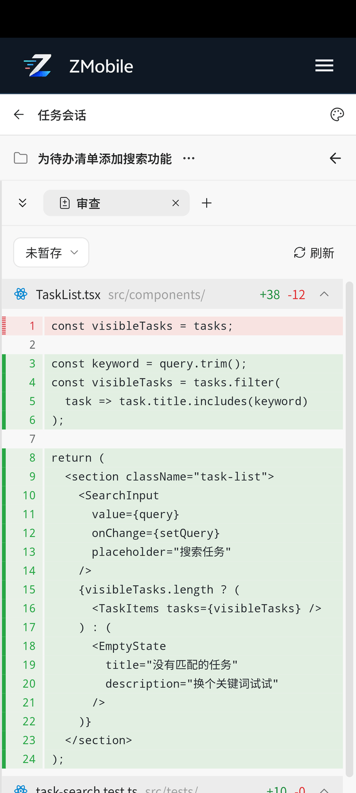
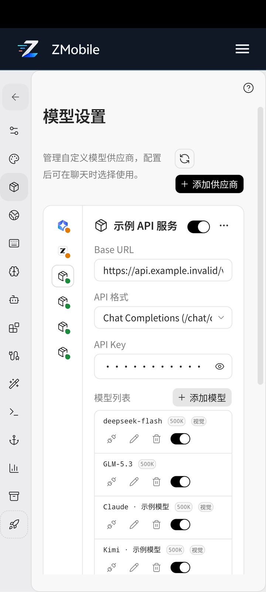

# ZCode Mobile App

[](https://kotlinlang.org/)
[](https://developer.android.com/)
[](https://developer.android.com/develop/ui/views/layout/webapps/webview)
[](LICENSE)

[Simplified Chinese](README.md) | **English**

ZCode Mobile App is a third-party Android client for ZCode remote control pages, supporting Android 7.0 and later.

ZCode Mobile App wraps the official remote control page in a native shell: it uses an app container instead of the mobile browser to host the page, and adapts it for phone screens, touch interaction, and system behavior, making remote control more stable and usable on mobile.

> Note: This app does not replace ZCode's remote execution capabilities. It focuses on connection management, the native container, and mobile interaction optimization.

## Screenshots

The following screenshots show the current app on a real device. Click an image to view the original. Connection names, accounts, tasks, code, and service settings have been replaced with examples; these examples were not saved to the real workspace. Model names and capability badges illustrate the menu and settings layouts.

<table>
  <tr>
    <td width="33%" align="center"><a href="images/zmobile-connections.png"></a><br><b>Connection Management</b><br>Save multiple computers, view connection status, and reorder the list.</td>
    <td width="33%" align="center"><a href="images/zmobile-workspaces.png"></a><br><b>Projects and Tasks</b><br>Browse and switch tasks by project after connecting to ZCode.</td>
    <td width="33%" align="center"><a href="images/zmobile-conversation.png"></a><br><b>Task Conversations</b><br>Read results, ask follow-up questions, and open code changes.</td>
  </tr>
  <tr>
    <td align="center"><a href="images/zmobile-model-menu.png"></a><br><b>Model Selection</b><br>Choose a model and view its capabilities and thinking intensity.</td>
    <td align="center"><a href="images/zmobile-code-review.png"></a><br><b>Code Review Panel</b><br>Browse files and review added and deleted lines in the side panel.</td>
    <td align="center"><a href="images/zmobile-model-settings.png"></a><br><b>Model Settings</b><br>View providers, model lists, and capability settings on your phone.</td>
  </tr>
</table>

## Features

- **Connection Management:** Connect by scanning a QR code, entering a URL, or using a clipboard shortcut. Save, edit, copy, delete, and reorder multiple connections by long-pressing and dragging.
- **Session Memory:** Remembers the most recent task session for each connection and attempts to restore the connection and session when the app resumes.
- **Event Notifications:** Supports task completion, task failure, approval requests, and questions. Each type can be enabled separately; tapping a notification opens the corresponding task session.
- **Background Keep-Alive:** An optional foreground service and screen-off WakeLock reduce background disconnections, with guidance for battery optimization settings.
- **Display Settings:** Supports immersive full-screen mode, a configurable top bar, and full-page scaling. Includes Light, Dark, and Graphite themes.
- **Page Adaptation:** Improves narrow-screen layouts for task lists, settings, and dialogs, adjusts conversation input text size, and reduces unwanted keyboard activation when opening project or model menus.
- **Mobile Interaction:** Handles Back actions by page level, keeps inputs clear of the keyboard, reduces accidental touches, and supports long-press text selection.
- **Security Features:** Supports fingerprint authentication and pattern verification.
- **Interface Language:** Supports Simplified Chinese, English, and following the system language.
- **Campaign Reminders:** Shows an in-session pop-up when the account has an available ZCode token reward campaign.
- **In-App Updates:** Can check GitHub Releases on startup, download APKs, launch the system installer, and ignore a selected version.

## Quick Start

1. Download and install the release APK from [GitHub Releases](https://github.com/my-dlq/zcode-mobile-app/releases).
2. Enable remote control in ZCode on your computer, obtain the remote URL or QR code, and keep the computer online.
3. Open the app and use the menu to scan a QR code or add a connection. If the clipboard contains a recognizable remote URL, you can also use the quick-connect option.
4. Tap a saved connection to open the remote page. If it says it is waiting for pairing confirmation on the desktop, complete the required connection or pairing steps on the computer before selecting a project and task session.

You can save multiple connections. **Only the most recently opened connection is monitored**; switching connections also switches the event source.

### Two Settings Areas

| Entry Point | Purpose |
| --- | --- |
| Settings in the app menu | Display, themes, language, notifications, security verification, background keep-alive, and app updates |
| Settings inside the remote page | ZCode workspace, model, plugin, and other remote settings; available options depend on the official page |

## Notifications and Back Navigation

### Four Notification Types

| Type | What It Tells You |
| --- | --- |
| Approval request | A task needs you to approve or reject an action |
| Question | A task needs an answer or additional information |
| Task completion | A task or background executor reports completion |
| Task failure | A task reports failure |

- Enable notifications and the desired event types in the app's notification settings, and grant the system notification permission.
- When you are viewing a task session in the foreground, its events do not produce duplicate system notifications. Events from other sessions still follow your notification settings.
- Tapping a notification opens the corresponding connection and task session. The remote URL and target session must remain accessible.
- To receive notifications in the background, enable background keep-alive and adjust battery restrictions as prompted by your phone. Monitoring may stop if the computer goes offline, the network disconnects, or the app is force-stopped.

### System Back Button and Back Gesture

| Current Screen | Back Action |
| --- | --- |
| Keyboard, menu, dialog, or side panel is open | Dismiss the keyboard or close the topmost overlay first |
| Task session, settings detail, or another nested page | Return to the previous page level |
| Remote task home page | Press Back again within the prompted time window to open the app's connection list |
| App connection list | Return directly to the phone's home screen |

Returning to the phone's home screen from the connection list retains the remote page in the background, and background keep-alive continues according to your settings. If the background page is still alive, reopening the app returns to the connection list. If Android has reclaimed the process, the app attempts to restore the most recent connection and session.

## Frequently Asked Questions

**Why does the page keep waiting for desktop pairing confirmation?**

Make sure ZCode is online on the computer, the current remote control entry is valid, and any required desktop pairing is complete. If the URL has expired, obtain a new remote URL and update the saved connection.

**Why am I not receiving task notifications?**

Check the app's notification master switch, the relevant event type, and the system notification permission. Confirm that the currently opened connection is the one producing the events. Notifications are suppressed while you are viewing the same session in the foreground. For background notifications, also check keep-alive and battery restrictions.

**Why is the background service notification still visible after I return to the home screen?**

Returning to the home screen closes the foreground interface while background keep-alive may continue. Turn off background keep-alive in app settings if you no longer need it.

**What should I do if the official page changes and the layout or controls stop working correctly?**

First check that you have the latest available APK. If the issue persists, open an Issue with your phone model, Android version, app version, and steps to reproduce. Remove remote URLs, device identifiers, and tokens from logs and screenshots before sharing them.

## Local Data and Connections

- The app saves connection URLs, connection names, recent sessions, and user preferences locally on the phone.
- To deliver notifications and deduplicate events, a local SQLite database also stores task identifiers, titles, event types, and processing states.
- WebView connects to the corresponding remote services for pages and communication. This project does not provide an additional remote data relay service. WebView manages page login state and caches.
- Remote URLs may contain connection credentials. Do not include real URLs in public documentation, Issues, or screenshots.

## Tech Stack

| Category | Technology |
| --- | --- |
| Language | Kotlin 1.9.24 |
| UI | Android View, XML, ViewBinding, Material Components |
| Web Container | AndroidX WebKit, system Chromium WebView |
| QR Scanning | CameraX 1.3.3, ZXing Core 3.5.3 |
| Storage | SharedPreferences, Gson, SQLite (notification delivery and deduplication) |
| Minimum Version | Android 7.0 / API 24 |
| Compile Target | compileSdk 34 / targetSdk 34 |
| Java | JDK 17 |
| Build | Gradle, Android Gradle Plugin 8.4.1 |

## Prerequisites

- Android Studio Hedgehog, Iguana, Jellyfish, or newer
- JDK 17
- Android SDK Platform 34
- Android SDK Build Tools
- An Android emulator or an Android device with USB debugging enabled

Before building, point `JAVA_HOME` to JDK 17 and configure the local Android SDK through Android Studio.

## Build and Test

Run from the project root:

The following commands apply to macOS, Linux, or Git Bash. In Windows PowerShell or CMD, replace `./gradlew` with `.\gradlew.bat`.

```bash
# Build the Debug APK
./gradlew assembleDebug

# Build the Release APK
./gradlew assembleRelease

# Run JVM unit tests
./gradlew testDebugUnitTest

# Run Android instrumented tests, requires a connected device or emulator
./gradlew connectedDebugAndroidTest

# Run static analysis
./gradlew lint
```

APK output paths (`<version>` is the `versionName` in `app/build.gradle.kts`):

```text
app/build/outputs/apk/debug/zcode-mobile-app-v<version>-debug.apk
app/build/outputs/apk/release/zcode-mobile-app-v<version>.apk
```

The debug package is `ai.zcode.remote.debug`, and the release package is `ai.zcode.remote`. They can be installed together; connection data and login state are separate.

## Development Conventions

- Organize new features under `ui/<feature>`, with page-private components in the matching feature directory.
- Put data models in `data/model` and persistence logic in `data/repository`.
- Keep WebView logic in `ui/remote/web`.
- Register new Activities in the Manifest and launch them through the target Activity's `start(...)` method.
- User-facing text and code comments are in Chinese, following the existing project style.
- Before changing WebView injection rules, confirm the remote DOM structure first, then verify against the real page via emulator/CDP.
- Group related changes into one logical commit and describe the behavior changes and verification results. Automated collaborators should commit, push, and merge only as authorized by the maintainer.

## Contributing

Issues, suggestions, and pull requests are welcome.

### Submitting an Issue

Please include as much of the following as possible:

- Phone or emulator model
- Android version
- App version or APK build time
- Steps to reproduce
- Screenshots or screen recordings
- Relevant logs (remember to remove remote links, device IDs, tokens, and other sensitive information)

### Submitting a Pull Request

1. Fork this project and create a separate branch, for example `feature/xxx` or `fix/xxx`.
2. Keep the scope of changes focused; avoid mixing unrelated refactoring into a bug fix.
3. For Android UI changes, verify on an emulator or a real device.
4. For WebView injection changes, verify both the native layer (adb / screenshots) and the CDP page layer, and describe your verification environment and results in the pull request.
5. Provide a clear commit message and test results.

## Disclaimer

- This project is an independent, community-developed third-party open-source client with **no affiliation** to [ZCode](https://zcode.z.ai) / Z.ai, and has received no official authorization, sponsorship, or endorsement.
- "ZCode", "Z.ai", and related names, trademarks, and logos belong to their respective owners; this project references them solely to denote the official product.
- The task progress, charts, terminal output, and other page content shown in the app are generated and hosted by ZCode's official remote service. Official remote addresses (such as `https://zcode.z.ai/remote`) are owned and operated by ZCode. This project handles client connections and display adaptation; see "Local Data and Connections" for information saved on the phone.
- This project adapts the official page for mobile display by injecting CSS/JS, which may break when the official page is redesigned; please do not attribute resulting display or usage issues to the official side.
- When using this project to connect to remote services, please follow ZCode's official terms of service and license agreements. Use is at your own risk.

## License

This project is released under the [MIT License](LICENSE).
